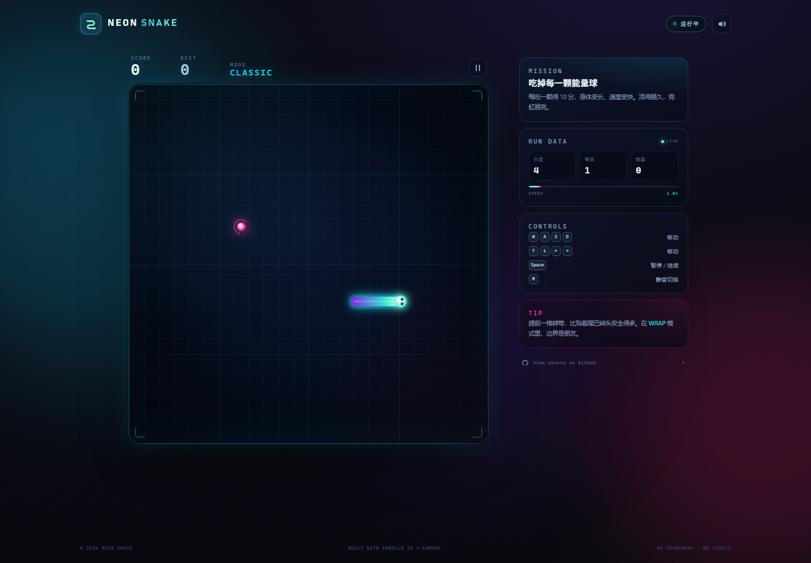

<div align="center">



<h1>NEON SNAKE · 霓虹贪吃蛇</h1>

<p>用原生 JavaScript 与 Canvas 打造的霓虹街机风贪吃蛇。<br />无框架、无依赖、无构建步骤，打开即玩。</p>

<p>
  <a href="https://github.com/zmmiffy/neon-snake"><strong>▶ 查看源码</strong></a>
  &nbsp;·&nbsp;
  <a href="#本地运行">本地运行</a>
  &nbsp;·&nbsp;
  <a href="https://github.com/zmmiffy/neon-snake/issues">问题反馈</a>
</p>

<p>
  
  
  
  
</p>

</div>

---

## 玩法

吃掉棋盘上的粉色能量球，每颗 **+10 分**。身体会变长、速度会变快，别撞墙，也别咬到自己。

- **CLASSIC 经典模式**：撞到边界即结束。
- **WRAP 穿墙模式**：从一侧穿出，从另一侧回来。

每吃 4 颗能量球升 1 级，移动间隔从 **152ms** 逐步缩短到 **66ms**。填满整块棋盘会触发 **PERFECT RUN**。

## 特性

- **双模式**：经典撞墙与穿墙循环，成绩分别记录。
- **渐进难度**：等级、速度、长度实时反馈，越玩越紧张。
- **顺滑渲染**：格子间插值移动、发光蛇身、粒子爆发、屏幕震动与死亡闪屏。
- **原创音效**：Web Audio 实时合成，没有音频素材，可一键静音。
- **本地记录**：按模式分别保存历史最佳，刷新页面也不会丢。
- **全端可玩**：键盘、触屏方向键、棋盘滑动都支持；桌面与移动端自适应。
- **无障碍细节**：键盘焦点可见、`prefers-reduced-motion` 降级、屏幕阅读器播报。
- **可测试内核**：游戏规则与 DOM/Canvas 完全解耦，18 个单元测试覆盖核心逻辑。
- **零依赖**：没有 npm 运行时依赖，也没有打包步骤。

## 操作

| 操作 | 按键 |
| --- | --- |
| 移动 | `↑` `↓` `←` `→` 或 `W` `A` `S` `D` |
| 暂停 / 继续 | `Space` 或 `Esc` |
| 开始 / 重新开始 | `Enter` |
| 静音切换 | `M` |
| 触屏 | 在棋盘上滑动，或使用屏幕方向键 |

## 本地运行

需要 Node.js 20+（仅用于本地静态服务器，游戏本身不需要 Node）。

```bash
npm start
# NEON SNAKE → http://127.0.0.1:4173/
```

也可以使用任意静态服务器：

```bash
python -m http.server 4173
```

然后用浏览器打开 `http://127.0.0.1:4173/`。

> 不要直接双击 `index.html`：游戏使用 ES Modules，`file://` 协议下浏览器会拦截模块加载。

## 测试

```bash
npm test          # node --test
npm run test:core # 直接执行测试文件，输出更紧凑
```

测试覆盖：初始状态、方向解析、非法掉头、输入缓冲、撞墙、穿墙、进食成长、等级与速度上限、尾格移动、自撞、食物生成、满盘通关、重置与死亡后状态。

## 计分与规则

| 事件 | 结果 |
| --- | --- |
| 吃到能量球 | `+10` 分，长度 `+1` |
| 每吃 4 颗 | 等级 `+1`，速度提升 |
| 撞到边界（经典） | 游戏结束 |
| 撞到自己 | 游戏结束 |
| 填满棋盘 | 完美通关 |

历史最佳按模式独立保存在 `localStorage`：`neon-snake.best.classic` / `neon-snake.best.wrap`。

## 项目结构

```text
neon-snake/
├── index.html              # 页面骨架与 HUD
├── css/style.css           # 霓虹视觉系统与响应式布局
├── js/
│   ├── core.js             # 纯游戏规则（可在 Node 中测试）
│   ├── audio.js            # Web Audio 合成音效
│   └── game.js             # Canvas 渲染、输入、状态机
├── tests/core.test.mjs     # 18 个核心逻辑测试
├── scripts/serve.mjs       # 零依赖本地静态服务器
└── assets/screenshot.png   # 项目截图
```

`js/core.js` 不引用任何浏览器 API，因此同一套规则既跑在页面里，也跑在 Node 测试里。

## 部署

这是一个纯静态站点，没有构建步骤，可直接部署到任意静态托管。

仓库已包含预构建的 `gh-pages` 分支。使用 GitHub Pages 时，在 **Settings → Pages** 中选择：

- **Source**: `Deploy from a branch`
- **Branch**: `gh-pages` / `/ (root)`

保存后即可通过 `https://zmmiffy.github.io/neon-snake/` 访问，无需 GitHub Actions。`main` 分支保存源码，`gh-pages` 分支只包含运行游戏所需的静态文件。

## License

[MIT](LICENSE) © 2026 zmmiffy
